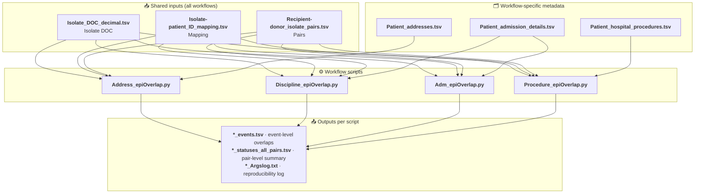

# 🧬 epidemiological-overlap

Scripts to contextualize Enterobacterales isolate transmission linkages with patient metadata and related analyses.

Based on work to recreate analyses in [Whole genome sequencing reveals hidden transmission of carbapenemase-producing Enterobacterales](https://doi.org/10.1038/s41467-022-30637-5) and [Plasmid dynamics driving carbapenemase gene dissemination in healthcare environments: a nationwide analysis of closed Enterobacterales genomes](https://doi.org/10.1038/s41467-025-64515-7).

Other source(s) of reference:
https://github.com/nataschamay/cp_transmission_2021

## 🔍 Overview

This repository contains a small analysis workflow for comparing isolate pairs against patient metadata and generating epidemiological overlap outputs.

There are four main workflow scripts:

| # | Script | Purpose |
| --- | --- | --- |
| 🏠 | [`tools/Address_epiOverlap.py`](tools/Address_epiOverlap.py) | compares isolate pairs by patient address information. |
| 🩺 | [`tools/Discipline_epiOverlap.py`](tools/Discipline_epiOverlap.py) | compares isolate pairs by discipline overlap between hospital stays of patients. |
| 🏥 | [`tools/Adm_epiOverlap.py`](tools/Adm_epiOverlap.py) | compares isolate pairs by hospital, ward, and bed overlap between hospital stays of patients. |
| 🔬 | [`tools/Procedure_epiOverlap.py`](tools/Procedure_epiOverlap.py) | compares isolate pairs by procedure overlap based on patient procedure records. |

The repository also includes comparison scripts used to validate the generated overlap outputs against independent reference sets.

## 🗺️ Visual Workflow

The diagram below maps how the four workflow scripts consume the shared inputs (**Isolate DOC**, **Mapping**, **Pairs**) together with their specific metadata file, and produce the `*_events.tsv`, `*_statuses_all_pairs.tsv`, and `*_Argslog.txt` outputs.



## 📑 Table of contents

- [Overview](#-overview)
- [Visual Workflow](#-visual-workflow)
- [Environment setup](#-environment-setup)
- [How the analysis pipeline works](#-how-the-analysis-pipeline-works)
- [Input and Output Files](#-input-and-output-files)
  - [Default Input Schema](#-default-input-schema)
- [Finding address overlap](#-finding-address-overlap)
- [Finding discipline overlap](#-finding-discipline-overlap)
- [Finding admission overlap](#-finding-admission-overlap)
- [Finding procedure overlap](#-finding-procedure-overlap)
- [Custom column order](#-custom-column-order)
- [Testing and validation](#-testing-and-validation)
- [Troubleshooting & Edge Cases](#-troubleshooting--edge-cases)
- [Notes](#-notes)
- [Citation & Acknowledgements](#-citation--acknowledgements)

## 🛠️ Environment setup

Create and activate a virtual environment, then install the project dependencies:

```bash
cd /path/to/epidemiological-overlap
python -m venv .venv
source .venv/bin/activate
pip install --upgrade pip
pip install -r requirements.txt
```

## ⚙️ How the analysis pipeline works

The scripts share the same general workflow:

1. **Load** the recipient/donor isolate pair list.
2. **Resolve** each isolate to a patient using the isolate-to-patient mapping.
3. **Read** patient-level metadata such as address, admission history, or procedure history.
4. **Compare** the relevant metadata for each pair.
5. **Write**:
   - an event-level table of overlapping records
   - a pair-level status table summarising each donor/recipient comparison
   - an argument log capturing the exact CLI configuration used

The project is intentionally **schema-driven rather than header-driven**. Input files are parsed primarily by column position, which makes it easier to work with TSVs that have variable header names or non-standard layouts.

Date handling is also standardized across workflows. The parsing logic accepts ISO dates, decimal-year dates, slash-delimited dates, and hyphen-delimited dates, with the CLI option `--decimal_date` used to request decimal-year output formatting when relevant.

## 📂 Input and Output Files

### Input files

The scripts read TSV files **by column position, not by exact header names**. For the default schema and detailed file descriptions, see:

- [Isolate_DOC_decimal.tsv](data/README.md#isolate_doc_decimaltsv)
- [Isolate-patient_ID_mapping.tsv](data/README.md#isolate-patient_id_mappingtsv)
- [Patient_addresses.tsv](data/README.md#patient_addressestsv)
- [Patient_admission_details.tsv](data/README.md#patient_admission_detailstsv)
- [Patient_hospital_procedures.tsv](data/README.md#patient_hospital_procedurestsv)
- [Recipient-donor_isolate_pairs.tsv](data/README.md#recipient-donor_isolate_pairstsv)

### 📊 Default Input Schema

Because the tool is **schema-driven rather than header-driven**, every input TSV is parsed against the default column order below (header names are illustrative; only the **positions** matter). If your file uses a different layout, see [Custom column order](#-custom-column-order).

**`Isolate_DOC_decimal.tsv`** — per-isolate date of culture, used by all four workflows:

| Position | Default column | Data type |
| :---: | --- | --- |
| 1 | `Isolate_ID` | string |
| 2 | `Date of Culture (DOC)` | date (ISO / slash / hyphen / decimal-year) |

**`Isolate-patient_ID_mapping.tsv`** — lookup linking each isolate to its patient, used by all four workflows:

| Position | Default column | Data type |
| :---: | --- | --- |
| 1 | `Isolate_ID` | string |
| 2 | `Patient_ID` | string |

**`Recipient-donor_isolate_pairs.tsv`** — recipient/donor isolate pairs to evaluate, used by all four workflows:

| Position | Default column | Data type |
| :---: | --- | --- |
| 1 | `Recip_isolate_ID` | string |
| 2 | `Donor_isolate_ID` | string |

For the workflow-specific metadata files (`Patient_addresses.tsv`, `Patient_admission_details.tsv`, `Patient_hospital_procedures.tsv`), see the detailed schemas in [data/README.md](data/README.md).

### Output files

The scripts generate event and status tables in the output folder. See the detailed descriptions for:

- [Address_epiOverlap_events.tsv](data/README.md#address_epioverlap_eventstsv)
- [Address_epiOverlap_statuses_all_pairs.tsv](data/README.md#address_epioverlap_statuses_all_pairstsv)
- [Discipline_epiOverlap_events.tsv](data/README.md#discipline_epioverlap_eventstsv)
- [Discipline_epiOverlap_statuses_all_pairs.tsv](data/README.md#discipline_epioverlap_statuses_all_pairstsv)
- [Adm_epiOverlap_events.tsv](data/README.md#adm_epioverlap_eventstsv)
- [Adm_epiOverlap_statuses_all_pairs.tsv](data/README.md#adm_epioverlap_statuses_all_pairstsv)
- [Procedure_epiOverlap_events.tsv](data/README.md#procedure_epioverlap_eventstsv)
- [Procedure_epiOverlap_statuses_all_pairs.tsv](data/README.md#procedure_epioverlap_statuses_all_pairstsv)

### 📁 Output File Dictionary

Each workflow writes up to three artifacts into the output folder you specify:

| File pattern | Contents |
| --- | --- |
| `*_events.tsv` | Row-level record of every specific overlapping event (e.g., shared ward, shared procedure) between a donor and recipient. |
| `*_statuses_all_pairs.tsv` | Pair-level summary indicating TRUE/FALSE or overlap duration for every queried donor-recipient pair, regardless of whether an overlap was found. |
| `*_Argslog.txt` | Reproducibility log capturing the exact CLI arguments and timestamp. |

## 🏠 Finding address overlap

### Check the CLI usage

```bash
python ./tools/Address_epiOverlap.py --help
```

This shows the required arguments and the expected input schema.

### Run the analysis

<details>
<summary><b>▶ Show example command</b></summary>

```bash
python ./tools/Address_epiOverlap.py \
  --isolate_DOC ./data/demo/inputs/Isolate_DOC_decimal.tsv \
  --isolate_patient_mapping ./data/demo/inputs/Isolate-patient_ID_mapping.tsv \
  --patient_address ./data/demo/inputs/Patient_addresses.tsv \
  --isolate_pairs ./data/demo/inputs/Recipient-donor_isolate_pairs.tsv \
  --output_folder ./data/demo/outputs
```

</details>

This writes files such as:

- [Address_epiOverlap_events.tsv](data/README.md#address_epioverlap_eventstsv)
- [Address_epiOverlap_statuses_all_pairs.tsv](data/README.md#address_epioverlap_statuses_all_pairstsv)
- `Address_epiOverlap_Argslog.txt`
  - log file containing the command-line arguments and execution details.

into the output folder you specify.

## 🩺 Finding discipline overlap

### Check the CLI usage

```bash
python ./tools/Discipline_epiOverlap.py --help
```

This shows the required arguments for thediscipline overlap analysis.

### Run the analysis

<details>
<summary><b>▶ Show example command</b></summary>

```bash
python ./tools/Discipline_epiOverlap.py \
  --isolate_DOC ./data/demo/inputs/Isolate_DOC_decimal.tsv \
  --isolate_patient_mapping ./data/demo/inputs/Isolate-patient_ID_mapping.tsv \
  --patient_admission_details ./data/demo/inputs/Patient_admission_details.tsv \
  --isolate_pairs ./data/demo/inputs/Recipient-donor_isolate_pairs.tsv \
  --output_folder ./data/demo/outputs
```

</details>

Optional decimal-date output:

<details>
<summary><b>▶ Show example command (<code>--decimal_date</code>)</b></summary>

```bash
python ./tools/Discipline_epiOverlap.py \
  --isolate_DOC ./data/demo/inputs/Isolate_DOC_decimal.tsv \
  --isolate_patient_mapping ./data/demo/inputs/Isolate-patient_ID_mapping.tsv \
  --patient_admission_details ./data/demo/inputs/Patient_admission_details.tsv \
  --isolate_pairs ./data/demo/inputs/Recipient-donor_isolate_pairs.tsv \
  --output_folder ./data/demo/outputs_decimal \
  --decimal_date
```

</details>

This writes files such as:

- [Discipline_epiOverlap_events.tsv](data/README.md#discipline_epioverlap_eventstsv)
- [Discipline_epiOverlap_statuses_all_pairs.tsv](data/README.md#discipline_epioverlap_statuses_all_pairstsv)
- `Discipline_epiOverlap_Argslog.txt`
  - log file containing the command-line arguments and execution details.

into the output folder you specify.

## 🏥 Finding admission overlap

### Check the CLI usage

```bash
python ./tools/Adm_epiOverlap.py --help
```

This shows the required arguments for the hospital, ward, and bed overlap analysis.

### Run the analysis

<details>
<summary><b>▶ Show example command</b></summary>

```bash
python ./tools/Adm_epiOverlap.py \
  --isolate_DOC ./data/demo/inputs/Isolate_DOC_decimal.tsv \
  --isolate_patient_mapping ./data/demo/inputs/Isolate-patient_ID_mapping.tsv \
  --patient_admission_details ./data/demo/inputs/Patient_admission_details.tsv \
  --isolate_pairs ./data/demo/inputs/Recipient-donor_isolate_pairs.tsv \
  --output_folder ./data/demo/outputs
```

</details>

Optional decimal-date output:

<details>
<summary><b>▶ Show example command (<code>--decimal_date</code>)</b></summary>

```bash
python ./tools/Adm_epiOverlap.py \
  --isolate_DOC ./data/demo/inputs/Isolate_DOC_decimal.tsv \
  --isolate_patient_mapping ./data/demo/inputs/Isolate-patient_ID_mapping.tsv \
  --patient_admission_details ./data/demo/inputs/Patient_admission_details.tsv \
  --isolate_pairs ./data/demo/inputs/Recipient-donor_isolate_pairs.tsv \
  --output_folder ./data/demo/outputs_decimal \
  --decimal_date
```

</details>

This writes files such as:

- [Adm_epiOverlap_events.tsv](data/README.md#adm_epioverlap_eventstsv)
- [Adm_epiOverlap_statuses_all_pairs.tsv](data/README.md#adm_epioverlap_statuses_all_pairstsv)
- `Adm_epiOverlap_Argslog.txt`
  - log file containing the command-line arguments and execution details.

into the output folder you specify.

## 🔬 Finding procedure overlap

### Check the CLI usage

```bash
python ./tools/Procedure_epiOverlap.py --help
```

This shows the required arguments for the procedure overlap analysis.

### Run the analysis

<details>
<summary><b>▶ Show example command</b></summary>

```bash
python ./tools/Procedure_epiOverlap.py \
  --isolate_DOC ./data/demo/inputs/Isolate_DOC_decimal.tsv \
  --isolate_patient_mapping ./data/demo/inputs/Isolate-patient_ID_mapping.tsv \
  --patient_procedure_details ./data/demo/inputs/Patient_hospital_procedures.tsv \
  --isolate_pairs ./data/demo/inputs/Recipient-donor_isolate_pairs.tsv \
  --output_folder ./data/demo/outputs
```

</details>

Optional decimal-date output:

<details>
<summary><b>▶ Show example command (<code>--decimal_date</code>)</b></summary>

```bash
python ./tools/Procedure_epiOverlap.py \
  --isolate_DOC ./data/demo/inputs/Isolate_DOC_decimal.tsv \
  --isolate_patient_mapping ./data/demo/inputs/Isolate-patient_ID_mapping.tsv \
  --patient_procedure_details ./data/demo/inputs/Patient_hospital_procedures.tsv \
  --isolate_pairs ./data/demo/inputs/Recipient-donor_isolate_pairs.tsv \
  --output_folder ./data/demo/outputs_decimal \
  --decimal_date
```

</details>

This writes files such as:

- [Procedure_epiOverlap_events.tsv](data/README.md#procedure_epioverlap_eventstsv)
- [Procedure_epiOverlap_statuses_all_pairs.tsv](data/README.md#procedure_epioverlap_statuses_all_pairstsv)
- `Procedure_epiOverlap_Argslog.txt`
  - log file containing the command-line arguments and execution details.

into the output folder you specify.

## 🔢 Custom column order

If a file has a different layout, you can override the expected column positions directly in the path. All scripts use the numbered order you provide rather than matching on explicit column names.

Example:

<details>
<summary><b>▶ Show example command</b></summary>

```bash
python ./tools/Address_epiOverlap.py \
  --patient_address ./data/my_inputs/addresses.tsv[1,3,2,5] \
  --isolate_DOC ./data/my_inputs/isolate_doc.tsv[2,1] \
  --isolate_patient_mapping ./data/my_inputs/mapping.tsv[2,1] \
  --isolate_pairs ./data/my_inputs/pairs.tsv[2,1] \
  --output_folder ./data/testout
```

</details>

In this example, the parser reads the specified numeric columns in the order shown before processing the file. This lets you keep the same script logic even when the input files use different column layouts or alternate header names.

## ✅ Testing and validation

The repository includes regression tests under the `tests/` directory for the main epidemiological overlap workflows. These are designed to check that the core logic remains consistent as the input schemas and date-handling rules evolve.

A typical validation run is:

```bash
pytest -q
```

You can also run a single workflow test, for example:

```bash
pytest -q tests/Address_epiOverlap_test.py
```

The demo datasets under `data/demo/inputs` and `data/demo/outputs` are useful for smoke testing the full end-to-end flow before running on real data.

## ❓ Troubleshooting & Edge Cases

### Date parsing

**How are dates interpreted?** The parsing logic accepts ISO dates (`2020-01-10`), slash-delimited dates (`06/09/2010`), hyphen-delimited dates (`06-09-2010`), and decimal-year values (`2010.682192`). Use the CLI option `--decimal_date` to request decimal-year output formatting when relevant.

**What happens if a date fails to parse?** The scripts raise an error identifying the isolate and the offending value, e.g. `Could not parse date for isolate 'ISO201': '...'`. Check that the cell contains one of the supported formats above and re-run.

### Missing values

Missing values such as `n.a`, `NA`, or blank cells are treated as absent where applicable (see [Notes](#-notes)). A pair with absent metadata simply yields no overlapping event for that field; it still appears in the `*_statuses_all_pairs.tsv` summary.

### Column mismatch errors

Because input files are parsed **by column position**, an index error or obviously wrong output usually means the file's actual layout differs from the [Default Input Schema](#-default-input-schema). Quick fix: append the positional override to the file path — for example `--isolate_pairs ./data/my_inputs/pairs.tsv[2,1]` — listing the columns in the order the script expects. See [Custom column order](#-custom-column-order) for details.

## 📝 Notes

- Missing values such as `n.a` or blank cells are treated as absent where applicable.
- Date values can include standard ISO formats, slash-delimited dates, hyphen-delimited dates, and decimal-year values.
- The scripts are intended for TSV inputs and assume a header row is present, but they do not rely on exact header names.
- The workflow is designed to compare donor/recipient isolate pairs, then write both event-level evidence and summary-level status tables for each pair.
- If you are working with a custom file layout, use the positional override syntax described in the section below to select the correct columns without rewriting the script logic.

## 📚 Citation & Acknowledgements

If you use this repository in your work, please cite the publications whose analyses it recreates:

> May, N. *et al.* Whole genome sequencing reveals hidden transmission of carbapenemase-producing Enterobacterales. *Nature Communications* (2022). https://doi.org/10.1038/s41467-022-30637-5

> Plasmid dynamics driving carbapenemase gene dissemination in healthcare environments: a nationwide analysis of closed Enterobacterales genomes. *Nature Communications* (2025). https://doi.org/10.1038/s41467-025-64515-7

Acknowledgement: this project builds on the original implementation in the [`nataschamay/cp_transmission_2021`](https://github.com/nataschamay/cp_transmission_2021) repository.
